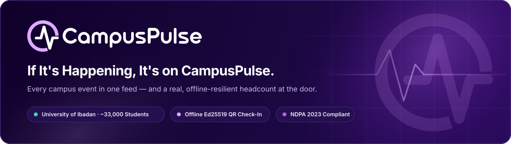
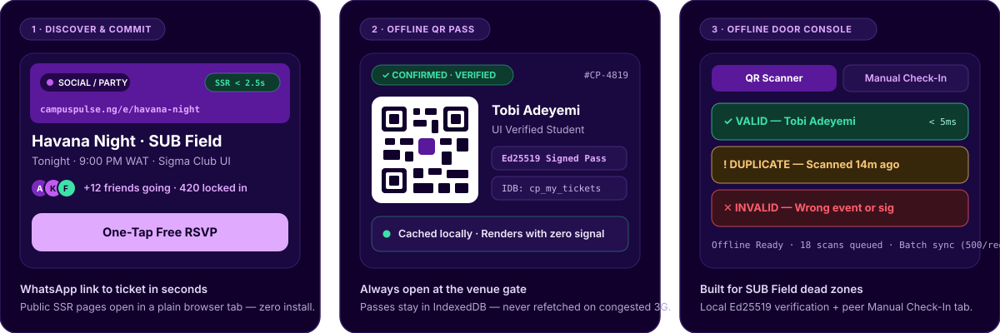
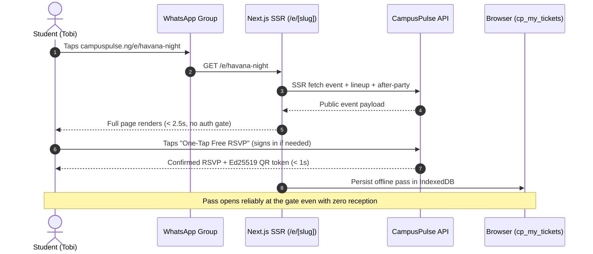
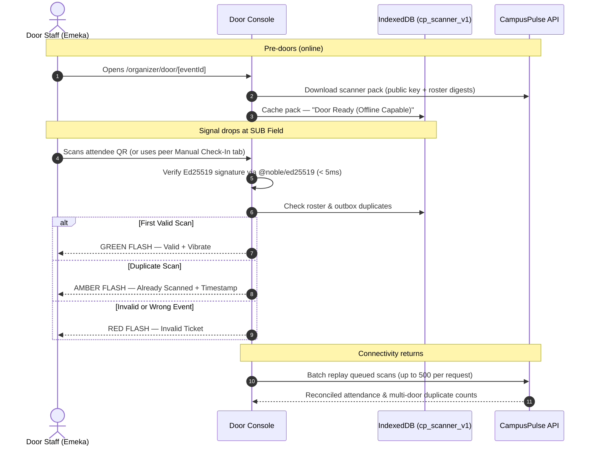
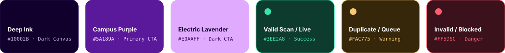
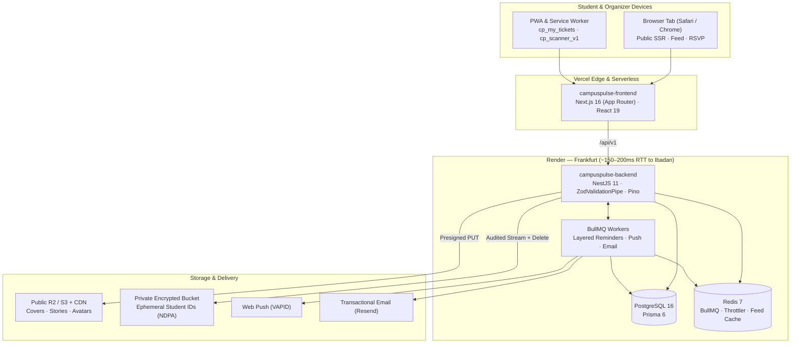
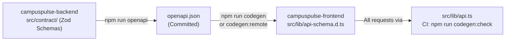
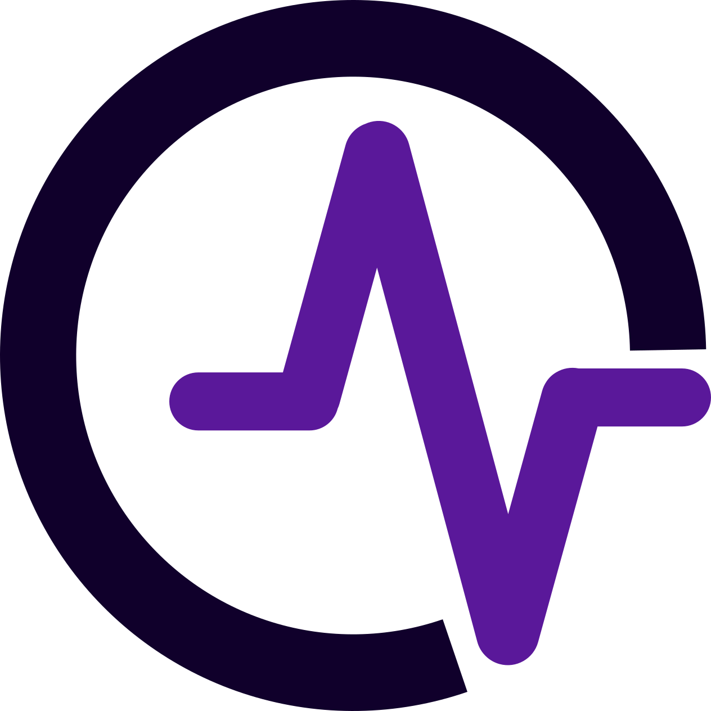

<p align="center">
  
</p>

<p align="center">
  <strong>CampusPulse Web</strong> is the attendee feed, public SSR event experience, organizer console, offline door scanner, and super-admin platform launching at the <strong>University of Ibadan (~33,000 students)</strong>.
</p>

<p align="center">
  <a href="https://github.com/CampusPulse-dev/campuspulse-frontend/actions/workflows/ci.yml"></a>
  <a href="https://github.com/CampusPulse-dev/campuspulse-frontend/actions/workflows/security.yml"></a>
  <a href="https://github.com/CampusPulse-dev/campuspulse-backend/actions/workflows/ci.yml"></a>
  
  
  
</p>

<p align="center">
  <a href="#why-campuspulse">Why CampusPulse</a> &nbsp;·&nbsp;
  <a href="#product-showcase">Product Showcase</a> &nbsp;·&nbsp;
  <a href="#built-for-three-portals">Three Portals</a> &nbsp;·&nbsp;
  <a href="#how-it-works">How It Works</a> &nbsp;·&nbsp;
  <a href="#technical-architecture">Architecture</a> &nbsp;·&nbsp;
  <a href="#quick-start">Quick Start</a> &nbsp;·&nbsp;
  <a href="#contributing">Contributing</a>
</p>

---

## Why CampusPulse?

At the University of Ibadan, campus events currently live and die inside scattered WhatsApp broadcast lists and ephemeral Instagram stories. Organizers guess attendance until a crowd forms at the gate, students discover events hours too late, and when 500 students arrive at SUB Field where mobile reception drops out, digital check-in stalls.

**CampusPulse** connects discovery, commitment, and verified door entry into one fast, offline-resilient loop — built to run in any plain mobile browser tab without forcing students to install an app first.

| Campus Life Today                                 | With CampusPulse                                                                                             |
| :------------------------------------------------ | :----------------------------------------------------------------------------------------------------------- |
| Flyers buried across dozens of WhatsApp groups    | **One unified campus feed** with "Tonight" (~6h) mood filters and 24h organizer stories                      |
| Links force logins or slow client spinners        | **Server-rendered public `/e/[slug]` pages** open from WhatsApp in **< 2.5s** with zero auth gate            |
| Guesswork headcounts ("vibes at the gate")        | **Confirmed free RSVPs & waitlists** give organizers a real pre-event headcount                              |
| Tickets fail to load on congested 3G at the venue | **Offline QR passes** cached locally in IndexedDB render immediately with zero signal                        |
| Scanners lock up when reception drops             | **On-device Ed25519 door console** verifies tickets in **< 5ms** offline, with **Manual Check-In** beside it |
| Sensitive student IDs shared over email or chats  | **NDPA 2023 ephemeral verification**: non-downloadable admin stream, deleted immediately on decision         |

---

## Product Showcase

<p align="center">
  
</p>

---

## Built for Three Portals

CampusPulse serves three distinct campus groups inside one unified web application:

<table>
<tr>
<td valign="top" width="33.3%">

### Students (Attendees)

- **Instant discovery** across parties, arts, conferences, sports, and society events (`/`, `/explore`, `/search`)
- **Zero-install WhatsApp flow** — public `/e/[slug]` pages load immediately in Safari or Chrome
- **Social proof** — see mutual friends going and follow clubs or campus creators (`/friends`, `/o/[slug]`, `/c/[handle]`)
- **Offline QR wallet** — tickets cache in the browser so gate entry never depends on mobile data (`/tickets`)

</td>
<td valign="top" width="33.3%">

### Organizers & Door Staff

- **Fast event creation** with structured templates for parties, theatre showtimes, and live sports fixtures (`/organizer`)
- **24-hour Stories** linked directly to event RSVPs
- **Scoped team roles** — `Owner`, `Manager`, and event-specific `Door Staff` (`/organizer/[slug]/team`)
- **Offline Door Console** — local Ed25519 verification, running headcount, and peer **Manual Check-In** (`/organizer/door/[eventId]`)

</td>
<td valign="top" width="33.3%">

### Trust & Super Admin

- **Student verification** via `@stu.ui.edu.ng` email OTP or ephemeral ID upload (`/verify`)
- **NDPA-compliant ID viewer** — watermarked, non-downloadable stream; image deleted the instant a decision is saved (`/admin`)
- **Organizer & moderation queues** with 15-minute soft locks so queues keep moving
- **Immutable AuditLog** & platform feature flags (`/admin/audit`, `/admin/settings`)

</td>
</tr>
</table>

---

## Campus Categories & Launch Targets

<table>
<tr>
<td valign="top" width="52%">

### Five Fixed Event Categories

| Category                  | Accent    | Typical UI Venues & Events                    |
| :------------------------ | :-------- | :-------------------------------------------- |
| **Social / Party**        | `#C25CF0` | SUB Field nights, hall weeks, concerts        |
| **Performance / Arts**    | `#FF9EB0` | Wole Soyinka Theatre plays, cultural shows    |
| **Academic / Conference** | `#7FB2F0` | ICC symposia, faculty seminars, tech summits  |
| **Sports / Recreation**   | `#3EE2A8` | UI Sports Complex fixtures, inter-hall finals |
| **Club / Society**        | `#FAC775` | General meetings, JCI/GDG sessions, socials   |

</td>
<td valign="top" width="48%">

### First-Semester Targets (UI Launch)

| Metric                        | Target                          |
| :---------------------------- | :------------------------------ |
| Weekly Active Students        | **8,000+** (~25% of campus)     |
| RSVP → Check-In Conversion    | **≥ 60%** _(North-Star Metric)_ |
| Verified Organizer Accounts   | **150+**                        |
| Published Events / Week       | **40+**                         |
| Day-7 Attendee Retention      | **≥ 35%**                       |
| Verification Queue Median Age | **< 48 hours**                  |

</td>
</tr>
</table>

---

## How It Works

CampusPulse is built around a single measurable loop: **Discover → Commit → Attend → Measure**.

### 1. WhatsApp Link → Public SSR → Offline QR Pass



### 2. Zero-Signal Door Scanning & Batch Reconciliation



---

## Brand & Visual Identity

<p align="center">
  
</p>

- **Dark-Register First:** Campus life peaks in the evening — Deep Ink (`#10002B`) paired with Purple (`#5A189A`) and Electric Lavender (`#E0AAFF`) defines the primary mood, alongside full WCAG AAA Light Mode (`#FFFFFF`) for daytime outdoor readability.
- **Typography:** **Goodly** for display headlines, self-hosted **Inter** for UI copy (zero external font blocking), and **JetBrains Mono** for timestamps, live counters, and QR metadata.
- **Tokenized CSS:** UI components consume semantic CSS custom properties from [`src/styles/tokens.css`](src/styles/tokens.css) rather than hardcoded hex values.

---

## Technical Architecture

### System Topology



### Tech Stack

| Layer                | Technology                                                                       | Rationale                                                               |
| :------------------- | :------------------------------------------------------------------------------- | :---------------------------------------------------------------------- |
| **Frontend**         | Next.js 16 (`^16.4.5`), React 19, TypeScript 5.7                                 | SSR for WhatsApp link previews, ISR/streaming, strict typing            |
| **State & Motion**   | TanStack Query v5, Framer Motion                                                 | Resilient client caching and accessible reduced-motion transitions      |
| **Offline & Crypto** | IndexedDB (`cp_my_tickets`, `cp_scanner_v1`), `@noble/ed25519`, `jsqr`, `qrcode` | Sub-5ms on-device ticket signature verification with zero signal        |
| **Backend**          | NestJS 11, Prisma 6, PostgreSQL 16, Redis 7, BullMQ                              | ACID RSVP capacity checks, keyset pagination, async notification queues |
| **Contract**         | Zod (`campuspulse-backend`) → `openapi.json` → `openapi-typescript`              | Single source of truth; schema drift breaks CI the same day             |
| **Testing**          | Vitest 5, Testing Library, Playwright (Chromium + WebKit), Lighthouse            | Unit, browser E2E, mobile Safari offline, and LCP budget checks         |
| **Hosting**          | Vercel (Frontend) + Render Frankfurt (Backend)                                   | Fast edge SSR and low-latency West Africa connectivity                  |

### Contract-First API Pipeline

All API request and response types live in [`src/lib/api-schema.d.ts`](src/lib/api-schema.d.ts), generated directly from [`campuspulse-backend`](https://github.com/CampusPulse-dev/campuspulse-backend)'s OpenAPI specification. **Never hand-write DTOs or edit the generated file.**



```bash
npm run codegen          # Regenerate from a sibling ../campuspulse-backend checkout
npm run codegen:remote   # Regenerate from campuspulse-backend's published main branch
```

### Non-Negotiables & NDPA 2023 Data Protection

These are hard product and regulatory requirements enforced in reviews and CI:

- **SSR Public Event Pages (`< 2.5s`):** `/e/[slug]` must server-render for signed-out WhatsApp visitors with no auth wall or client fetch waterfall.
- **Plain Browser Tab First:** Feed, event details, and Free RSVP must work in a normal mobile tab without PWA installation.
- **Offline QR Pass:** Passes persist in `cp_my_tickets` (IndexedDB) and never require a network refetch at the venue door.
- **Peer Manual Check-In:** `[Manual Check-In]` always ships right beside `[QR Scanner]` — never hidden behind scanner failure.
- **NDPA 2023 Privacy:** Never put student emails in URLs, query strings, analytics payloads, or `console.log`. Student ID uploads go straight to private encrypted storage with `credentials: 'omit'` and `cache: 'no-store'`, render only in the Super Admin's audited ephemeral viewer, and are deleted upon decision. Signing out clears local door roster caches (`cp_scanner_v1`).

### Phased Delivery Roadmap

| Phase                      | Scope                                                                                                                                                                  | Status               |
| :------------------------- | :--------------------------------------------------------------------------------------------------------------------------------------------------------------------- | :------------------- |
| **Phase 1A — v1 Core**     | Verification, organizer publishing, public SSR, feed, 24h stories, Free RSVP, offline QR, peer Manual Check-In, Super Admin audit                                      | Built · V1 Hardening |
| **Phase 1B — v1 Addendum** | Tonight chips, persona onboarding, event templates, linked after-parties, team roles (`Owner`/`Manager`/`Door Staff`), waitlists, creator ambassador links, moderation | Built · V1 Hardening |
| **Phase 2 — v1.5**         | Vendor/Venue profiles, verified portfolio credits, attendee reviews, squads, event groups                                                                              | Planned              |
| **Phase 3 — v2+**          | Paid ticketing, native scanner app, multi-campus switcher, comments                                                                                                    | Future               |

---

## Quick Start

### Prerequisites

- **Node.js** `>= 22.0.0`
- **Git**
- **Docker** _(only required for Option B — running the local backend)_

### Option A — Instant Frontend Demo Mode (< 1 minute, no backend needed)

Run the full attendee, organizer, door scanner, and admin experiences locally using built-in UI demo fixtures:

```bash
git clone https://github.com/CampusPulse-dev/campuspulse-frontend.git
cd campuspulse-frontend
npm ci
cp .env.example .env.local
```

Set `NEXT_PUBLIC_DEMO_MODE="true"` in `.env.local`, then start the dev server:

```bash
npm run dev                     # → http://localhost:3000
```

### Option B — Full Local Stack (Frontend + Backend)

Start [`campuspulse-backend`](https://github.com/CampusPulse-dev/campuspulse-backend) first (`postgres`, `redis`, and `minio` via Docker):

```bash
git clone https://github.com/CampusPulse-dev/campuspulse-backend.git
cd campuspulse-backend
npm ci
cp .env.example .env            # Fill in secrets (e.g. openssl rand -base64 48)
npm run db:up                   # Starts Postgres, Redis & MinIO
npx prisma migrate dev          # Apply database schema
npm run dev                     # → http://localhost:3001/api/v1 (Swagger at /docs)
```

Then in a second terminal, launch the frontend pointing to `http://localhost:3001`:

```bash
git clone https://github.com/CampusPulse-dev/campuspulse-frontend.git
cd campuspulse-frontend
npm ci
cp .env.example .env.local      # Keep NEXT_PUBLIC_API_BASE_URL="http://localhost:3001"
npm run dev                     # → http://localhost:3000
```

---

## Engineering Reference

<details>
<summary><strong>Directory Structure</strong> — App Router portals, components, offline storage, and E2E suites</summary>

```text
campuspulse-frontend/
├── .github/
│   ├── assets/                 README brand banners & adaptive light/dark SVGs
│   └── workflows/              CI, live-stack E2E, security, release workflows
├── e2e/                        Playwright browser specs (Chromium + mobile Safari)
├── public/
│   ├── brand/                  App vector marks
│   ├── demo/                   Sample campus imagery for Demo Mode
│   └── sw.js                   Service Worker for offline ticket & door caching
└── src/
    ├── app/
    │   ├── (attendee)/         Public SSR feed, /e/[slug], /o/[slug], /c/[handle], /tickets, /verify
    │   ├── (auth)/             Sign-in, sign-up, < 30s persona onboarding
    │   ├── organizer/          Organizer console, event wizard, team roles, offline /door/[eventId]
    │   └── admin/              Super Admin verification queues, ephemeral ID viewer, moderation, audit
    ├── components/             Shared UI primitives & domain views
    ├── lib/                    Typed API client, api-schema.d.ts, IndexedDB offline ticket & door layers
    └── styles/                 Semantic CSS design tokens (tokens.css)
```

</details>

<details>
<summary><strong>NPM Scripts</strong> — Development, quality gates, contract codegen, and testing</summary>

| Command                           | Purpose                                                                 |
| :-------------------------------- | :---------------------------------------------------------------------- |
| `npm run dev`                     | Start Next.js development server on `:3000`                             |
| `npm run build` / `start`         | Build and serve production bundle                                       |
| `npm run format:check` / `format` | Check or apply Prettier formatting                                      |
| `npm run lint` / `lint:fix`       | Run ESLint (`--max-warnings=0`)                                         |
| `npm run typecheck`               | Run TypeScript (`tsc --noEmit`)                                         |
| `npm test` / `test:watch`         | Run Vitest unit & component tests                                       |
| `npm run test:e2e`                | Run Playwright tests across Chromium & WebKit                           |
| `npm run codegen`                 | Regenerate `api-schema.d.ts` from `../campuspulse-backend/openapi.json` |
| `npm run codegen:remote`          | Regenerate `api-schema.d.ts` from backend `main`                        |
| `npm run codegen:check`           | CI drift check against published backend spec                           |

</details>

<details>
<summary><strong>CI/CD & Security Workflows</strong> — Automated checks protecting <code>main</code></summary>

| Workflow                                             | Trigger                         | Checks                                                                                    |
| :--------------------------------------------------- | :------------------------------ | :---------------------------------------------------------------------------------------- |
| [`ci.yml`](.github/workflows/ci.yml)                 | Pull requests, pushes to `main` | Prettier format, ESLint, `tsc`, `codegen:check`, Vitest, production build, Playwright E2E |
| [`live-stack.yml`](.github/workflows/live-stack.yml) | Integration validation          | Live backend/frontend stack E2E & Lighthouse LCP verification                             |
| [`security.yml`](.github/workflows/security.yml)     | PR, push, weekly                | CodeQL analysis, Gitleaks secret scan, `npm audit`                                        |
| [`release.yml`](.github/workflows/release.yml)       | `v*.*.*` tags                   | Automated changelog generation from Conventional Commits                                  |

Vercel builds preview deployments automatically for every PR; production promotion is intentional and manual so mid-event deployments never disrupt live check-ins.

</details>

---

## Contributing

**Branch naming:** `<type>/<TICKET>-<slug>` — e.g., `feat/S2-03-story-viewer`

**Conventional Commits** (enforced scope): `events`, `identity`, `attendance`, `admin`, `health`, `contract`, `db`, `ci`, `docker`, `deps`, `config`, `docs`

```text
feat(attendance): verify offline QR tokens with Ed25519
fix(events): keep public event SSR under 2.5s cold load
```

**Pre-PR verification gate:**

```bash
npm run format:check && npm run lint && npm run typecheck && npm test && npm run build
```

**Husky hooks** (installed automatically via `npm ci`):

- `pre-commit` runs `lint-staged` + debug leftover scan (blocks `debugger`, `.only`, and `TODO`/`FIXME` without ticket references like `// TODO(S2-03): ...`).
- `commit-msg` validates Conventional Commit scopes via `commitlint`.
- `pre-push` runs `typecheck` and Vitest.

---

## CampusPulse Ecosystem

| Repository                                                                                        | Description                                                                                                                                                                     |
| :------------------------------------------------------------------------------------------------ | :------------------------------------------------------------------------------------------------------------------------------------------------------------------------------ |
| **[campuspulse-frontend](https://github.com/CampusPulse-dev/campuspulse-frontend)** _(this repo)_ | Next.js 16 web app, public SSR, offline QR wallet, door scanner, admin portal                                                                                                   |
| **[campuspulse-backend](https://github.com/CampusPulse-dev/campuspulse-backend)**                 | NestJS 11 API, Zod contracts, Prisma/PostgreSQL, Redis/BullMQ workers, [ADR 0001](https://github.com/CampusPulse-dev/campuspulse-backend/blob/main/docs/adr/0001-tech-stack.md) |
| **[CampusPulse_PRD](https://github.com/CampusPulse-dev/CampusPulse_PRD)**                         | Product Requirements Document & engineering specifications                                                                                                                      |

---

<p align="center">
  <picture>
    <source media="(prefers-color-scheme: dark)" srcset=".github/assets/logo-light.svg" />
    <source media="(prefers-color-scheme: light)" srcset=".github/assets/logo-dark.svg" />
    
  </picture>
  <br /><br />
  <strong>CampusPulse</strong><br />
  <em>The heartbeat of student life.</em><br /><br />
  Built at the University of Ibadan
</p>
