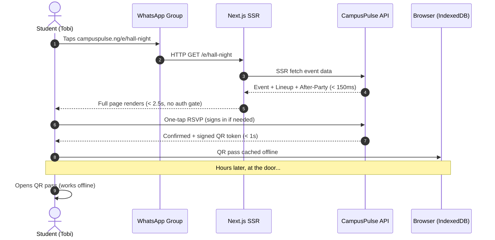
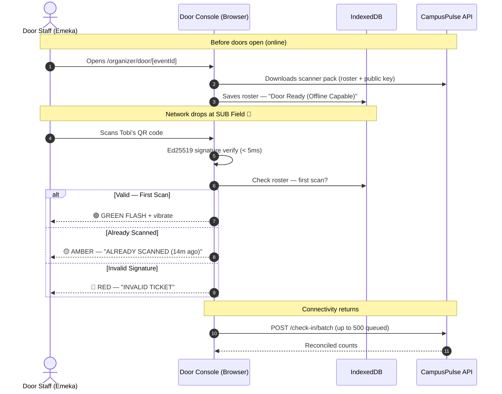
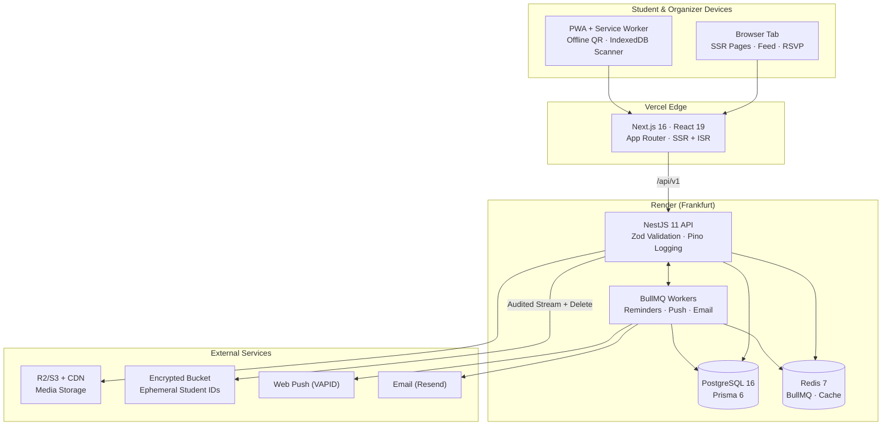

<p align="center">
  
</p>

<h3 align="center"><em>If It's Happening, It's on CampusPulse.</em></h3>

<p align="center">
  Every event on campus, in one feed. And a real headcount at the door.
</p>

<p align="center">
  <a href="https://github.com/CampusPulse-dev/campuspulse-backend/actions"></a>
  <a href="https://github.com/CampusPulse-dev/campuspulse-frontend/actions"></a>
  
  
  
</p>

---

## The Problem

At the University of Ibadan, campus events live and die on WhatsApp broadcast lists and Instagram stories. Organizers have **no headcount** until the queue forms at the door. Students find out about events too late, miss RSVPs, and get stuck in chaotic manual check-in lines. When 500 students show up at SUB Field and the network drops, nothing works.

**CampusPulse** replaces this with a single, fast, offline-resilient platform that connects discovery → commitment → verified door entry in one loop.

---

## What CampusPulse Does

<table>
<tr>
<td width="50%">

### 🎯 For Students (Attendees)

- **One feed for everything happening on campus** — parties, concerts, hall weeks, faculty symposia, sports matches
- **Public event pages that load in < 2.5s** — tapped from WhatsApp, no app install or sign-in required
- **One-tap free RSVP** with an offline-ready QR pass cached in your browser
- **"Tonight" mood chips** — see what's happening in the next 6 hours
- **Friends-going indicators** — know who's already locked in
- **Stories** — 24-hour ephemeral posts from organizers with direct event links
- **Works in a plain browser tab** — Safari, Chrome, no PWA install needed

</td>
<td width="50%">

### 🎤 For Organizers & Door Staff

- **Real pre-event headcount** — confirmed RSVPs before doors open, not vibes
- **Offline QR scanner** that works at SUB Field with zero signal
  - Cryptographic verification in < 5ms on-device
  - Scans queue locally and batch-sync when connectivity returns
- **Peer Manual Check-In tab** — always ships alongside the scanner, never hidden
- **Team roles** — Owner, Manager, Door Staff with scoped permissions
- **Ambassador links for Creators** — trackable RSVP + check-in attribution
- **Post-event analytics** — real attendance numbers, not estimates
- **Linked After-Parties** — gate access to parent event check-ins

</td>
</tr>
<tr>
<td width="50%">

### 🛡️ For the University & Trust

- **NDPA 2023 compliant** — student ID images are viewed only by verified Super Admins through audited, non-downloadable ephemeral streams, and **deleted immediately** upon verification decision
- **Email OTP** via `@stu.ui.edu.ng` as primary verification
- **Content moderation queue** with report triage
- **Immutable audit log** — every admin action is recorded
- **Platform settings & feature flags** for safe rollouts

</td>
<td width="50%">

### 📊 Launch Targets (First Semester)

| Metric | Target |
| :--- | :--- |
| Weekly Active Students | **8,000+** (~25% of UI) |
| RSVP → Check-In Conversion | **≥ 60%** |
| Verified Organizer Accounts | **150+** |
| Published Events / Week | **40+** |
| Day-7 Attendee Retention | **≥ 35%** |
| Verification Queue Median Age | **< 48 hours** |

</td>
</tr>
</table>

---

## How It Works — The Core Loop

```
 ┌──────────────┐     ┌──────────────┐     ┌──────────────┐     ┌──────────────┐
 │   DISCOVER   │────▶│   COMMIT     │────▶│   ATTEND     │────▶│   MEASURE    │
 │              │     │              │     │              │     │              │
 │ WhatsApp URL │     │ One-Tap RSVP │     │ Offline QR   │     │ Real Numbers │
 │ Feed + Stories│    │ + QR Pass    │     │ Door Scan    │     │ + Attribution│
 │ Tonight Chips│     │ cached local │     │ < 5ms verify │     │ + Reviews    │
 └──────────────┘     └──────────────┘     └──────────────┘     └──────────────┘
```

### The WhatsApp → RSVP → Door Flow



### Offline Door Scanning



---

## Technical Architecture

### System Topology



### Tech Stack

| Layer | Technology | Why |
| :--- | :--- | :--- |
| **Frontend** | Next.js 16 (App Router), React 19, TypeScript | SSR for WhatsApp OG previews, ISR for feed, PWA offline support |
| **Backend** | NestJS 11, TypeScript, Pino | Modular architecture, dependency injection, structured logging |
| **Database** | PostgreSQL 16 via Prisma 6 | ACID transactions for RSVP atomicity, keyset pagination |
| **Cache & Queues** | Redis 7 (noeviction), BullMQ | Rate limiting, session cache, async notification delivery |
| **API Contract** | Zod → OpenAPI → `openapi-typescript` codegen | Single source of truth; schema drift caught in CI |
| **Hosting** | Vercel (frontend), Render Frankfurt (backend) | Edge SSR + ~150ms RTT to Ibadan |
| **Storage** | Cloudflare R2 / S3 + CDN | Presigned uploads for event covers, stories, avatars |
| **Auth** | JWT (access) + httpOnly cookie (refresh) + scrypt | Stateless auth with secure token rotation |
| **QR Signing** | Ed25519 (offline) + HMAC-SHA256 (online) | Cryptographic verification without network at the door |

### Contract-First Development

The API contract flows in one direction — backend to frontend — with **zero hand-written DTOs**:

```
 campuspulse-backend                    campuspulse-frontend
 ┌─────────────────────┐                ┌─────────────────────┐
 │  src/contract/       │                │                     │
 │  ├── domain/*.ts     │  npm run       │  npm run codegen    │
 │  │   (Zod schemas)  │  openapi       │        │            │
 │  ├── api/*.ts        │────────▶       │        ▼            │
 │  └── registry.ts     │  openapi.json  │  src/lib/           │
 │                      │  (committed)   │  api-schema.d.ts    │
 │  CI: openapi:check   │                │  CI: codegen:check  │
 └─────────────────────┘                └─────────────────────┘
```

If you change a Zod schema in the backend:

```bash
# Backend — regenerate the OpenAPI spec
cd campuspulse-backend
npm run openapi

# Frontend — regenerate TypeScript types
cd campuspulse-frontend
npm run codegen
```

CI enforces staleness checks on both sides. A backend contract change that breaks the frontend **fails the frontend build the same day**.

### Performance Targets

| Metric | Target | How |
| :--- | :--- | :--- |
| Cold public event load | **< 2.5s** on 4G | SSR `/e/[slug]`, self-hosted fonts, WebP/AVIF images |
| RSVP confirmation | **< 1.0s** | Synchronous DB write + inline QR signing |
| Door scan verdict | **< 500ms** | On-device Ed25519 verify + IndexedDB duplicate check |
| Peak concurrency | **3,000 – 5,000** | Stateless horizontal scaling + Redis 30s feed cache |
| Scan burst (offline) | **1 scan / 1–2s** | Local crypto, no network round-trip |
| Availability | **99.5%** | Health probes, manual deploy promotion (no mid-event deploys) |

---

## Repository Map

| Repository | Stack | Description |
| :--- | :--- | :--- |
| **[campuspulse-frontend](https://github.com/CampusPulse-dev/campuspulse-frontend)** (this repo) | Next.js 16 · React 19 · TanStack Query · PWA | Attendee feed, organizer portal, super admin, QR wallet |
| **[campuspulse-backend](https://github.com/CampusPulse-dev/campuspulse-backend)** | NestJS 11 · Prisma 6 · PostgreSQL · Redis | API, Zod contracts, BullMQ workers, QR signing |

### Frontend Layout

```
src/
├── app/          App Router routes, layouts, server components
├── components/   Shared UI components
├── lib/          API client, hooks, generated types (api-schema.d.ts)
└── styles/       CSS tokens, global styles
e2e/              Playwright specs (Chromium + mobile Safari)
```

### Backend Layout

```
src/
├── contract/        Zod schemas — the source of truth for the API shape
├── config/          Environment schema, validated at boot
├── common/          Prisma, guards, filters, audit — shared across modules
├── modules/
│   ├── events/      Events, feed, stories
│   ├── identity/    Auth, accounts, verification
│   ├── attendance/  RSVP, check-in, notifications
│   └── admin/       Super admin portal, audit log
└── health/          Liveness and readiness probes
prisma/schema.prisma Data model
```

---

## Getting Started

### Prerequisites

- **Node.js** ≥ 20
- **Docker** (for local PostgreSQL + Redis)
- **Git**

### 1. Start the Backend

```bash
git clone https://github.com/CampusPulse-dev/campuspulse-backend.git
cd campuspulse-backend
npm ci
cp .env.example .env            # Fill in secrets (openssl rand -base64 48)
npm run db:up                   # Postgres + Redis via Docker
npx prisma migrate dev          # Apply schema
npm run dev                     # → http://localhost:3001/api/v1
```

Swagger UI: [`http://localhost:3001/docs`](http://localhost:3001/docs) (non-production only)

### 2. Start the Frontend

```bash
git clone https://github.com/CampusPulse-dev/campuspulse-frontend.git
cd campuspulse-frontend
npm ci
cp .env.example .env.local
npm run dev                     # → http://localhost:3000
```

> **Note:** The frontend expects the backend running on `http://localhost:3001`. Start the backend first.

### Useful Commands

| Command | Backend | Frontend |
| :--- | :--- | :--- |
| Dev server | `npm run dev` | `npm run dev` |
| Build | `npm run build` | `npm run build` |
| Lint | `npm run lint` | `npm run lint` |
| Typecheck | `npm run typecheck` | `npm run typecheck` |
| Unit tests | `npm test` | `npm test` |
| E2E tests | `npm run test:e2e` | `npm run test:e2e` |
| OpenAPI spec | `npm run openapi` | — |
| Type codegen | — | `npm run codegen` |
| DB Studio | `npm run db:studio` | — |

---

## Brand Identity

<table>
<tr>
<td align="center" width="33%">

**Deep Ink**<br/>
`#10002B`<br/>
Primary dark background

</td>
<td align="center" width="33%">

**Purple**<br/>
`#5A189A`<br/>
Brand CTA & accent

</td>
<td align="center" width="33%">

**Lavender**<br/>
`#E0AAFF`<br/>
Dark-mode primary CTA

</td>
</tr>
</table>

- **Display font:** Goodly (hero headlines, event titles)
- **Body font:** Inter (UI, navigation, forms — self-hosted, zero external requests)
- **Mono font:** JetBrains Mono (timestamps, counters, QR metadata)
- **Logo:** Circular `C` housing an ECG pulse waveform (`C + Pulse`)
- **Dark-register first:** Campus life peaks in the evening — the brand's default is deep violet with electric lavender

---

## Phased Roadmap

| Phase | Scope | Status |
| :--- | :--- | :--- |
| **Phase 1A** — v1 Core | Verify → Publish → Discover → Free RSVP → Offline Check-In | 🔨 Building |
| **Phase 1B** — v1 Addendum | Tonight chips, Friends, After-Parties, Creator Links, Team Roles, Waitlists | 📋 Planned |
| **Phase 2** — v1.5 | Vendor/Venue Profiles, Credits, Reviews, Squads, Event Groups | 📋 Planned |
| **Phase 3** — v2+ | Paid Ticketing, Native Scanner App, Multi-Campus, Comments | 🔮 Future |

---

## Five Event Categories

| Category | Color | Examples |
| :--- | :--- | :--- |
| 🎉 **Social / Party** | `#C25CF0` | SUB Field nights, hall week parties, concerts |
| 🎭 **Performance / Arts** | `#FF9EB0` | Wole Soyinka Theatre plays, cultural shows |
| 📚 **Academic / Conference** | `#7FB2F0` | ICC symposia, faculty seminars, workshops |
| ⚽ **Sports / Recreation** | `#3EE2A8` | UI Sports Complex matches, inter-hall games |
| 🏛️ **Club / Society** | `#FAC775` | Society meetings, committee events |

---

## Key Design Decisions

| Decision | Rationale |
| :--- | :--- |
| **SSR public event pages** | WhatsApp links must render instantly for signed-out visitors — no client-fetch waterfall, no auth gate |
| **Ed25519 offline QR** | Nigerian campus venues routinely have no signal; cryptographic signatures verify without any network round-trip |
| **Manual Check-In as a peer tab** | Camera glare, cracked screens, and dead phones are real. Never gate the fallback behind the scanner failing |
| **Contract-first codegen** | Two-repo split with zero hand-written DTOs eliminates API drift between teams |
| **Ephemeral ID deletion** | NDPA 2023 requires minimizing personal data retention; student IDs are destroyed the moment a decision is made |
| **BullMQ notification queues** | 5-stage layered reminders, quiet hours, daily caps — all async to keep RSVP responses under 1 second |
| **No paid ticketing in v1** | Prove the attendance loop first. Payment infrastructure is Phase 3 |

---

## Three Portals

| Portal | URL | Audience |
| :--- | :--- | :--- |
| **Attendee Web** | `campuspulse.ng` | Students — public feed, event pages, RSVP, QR wallet |
| **Organizer & Door Staff** | `campuspulse.ng/organizer/*` | Clubs & societies — event management, scanner, analytics |
| **Super Admin** | `campuspulse.ng/admin/*` | CampusPulse ops — verification, moderation, audit |

---

## Contributing

CampusPulse is currently developed by the founding team at the University of Ibadan. Contributions, feedback, and ideas are welcome.

**Branch naming:** `<type>/<TICKET>-<slug>` — e.g., `feat/S1-04-qr-scanner`

**Commits:** Conventional Commits with enforced scopes: `events`, `identity`, `attendance`, `admin`, `health`, `contract`, `db`, `ci`, `docker`, `deps`, `config`, `docs`

```
feat(attendance): sign RSVP QR tokens with a rotating secret
fix(events): keep feed keyset stable for equal start times
```

**Git hooks** (Husky, installed by `npm ci`):

| Hook | Runs |
| :--- | :--- |
| `pre-commit` | `lint-staged` + debug-leftover scan |
| `commit-msg` | commitlint |
| `pre-push` | typecheck + tests |

The pre-commit scan blocks `debugger`, focused tests (`.only`), and any `TODO`/`FIXME` without a ticket reference — write `// TODO(S2-03): …`.

---

## Non-Negotiables

These are product requirements, not preferences:

- **Public event pages must server-render** — a WhatsApp link opens a real, fast page for a signed-out visitor. Cold load budget: **2.5s**.
- **All three discovery steps work in a plain browser tab** — feed, event page, and RSVP cannot require PWA installation.
- **The QR ticket renders offline once loaded** — cache it; do not refetch it at the door on a saturated network.
- **Manual Check-In ships beside the scanner, always** — it is a peer tab, not a hidden fallback.
- **NDPA 2023 compliance** — never log request bodies or put student emails in URLs/analytics.

---

<p align="center">
  
  <br/>
  <strong>CampusPulse</strong>
  <br/>
  <em>The heartbeat of student life.</em>
  <br/><br/>
  Built with 💜 at the University of Ibadan 🇳🇬
</p>
